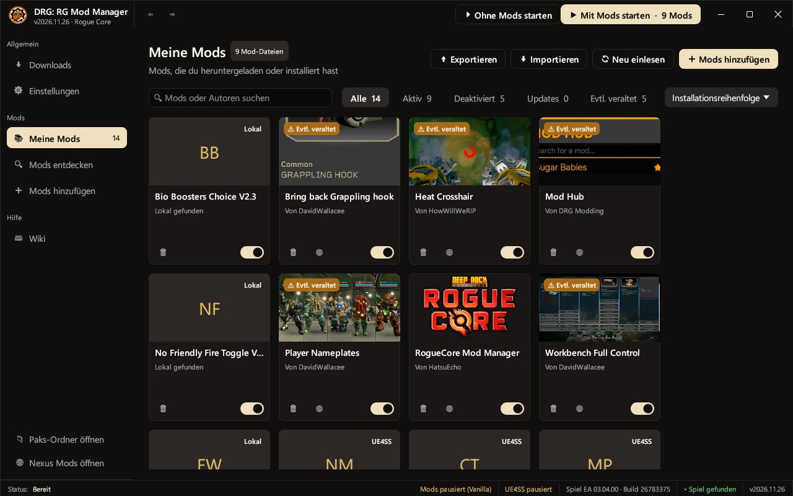

<div align="center">
  

  <h1>DRG: RG Mod Manager</h1>

  A mod manager for Deep Rock Galactic: Rogue Core.
  <br />
  <br />
  <a href="https://github.com/DasLykia/DRG-Rogue-Core-Mod-Manager/releases/latest">Download</a>
  ·
  <a href="https://www.nexusmods.com/games/deeprockgalacticroguecore/mods">Rogue Core mods on Nexus</a>
  ·
  <a href="https://github.com/DasLykia/DRG-Rogue-Core-Mod-Manager/issues">Report a bug</a>
  <br />
  <br />

  
</div>

## Features

- Browse and search every Rogue Core mod on Nexus Mods, with categories and sorting.
- Install mods straight from Nexus. Premium accounts download inside the app; free accounts use the "Mod Manager Download" button or a normal manual download, which the app picks up from your Downloads folder.
- Switch mods on and off, remove them, or drop in a `.pak` or `.zip` yourself. Mods already in your Paks folder are found automatically.
- UE4SS mods work too.
- See when a mod has a newer file on Nexus, or hasn't been updated since the last game patch.
- Start the game with or without mods in one click.
- Export your mod setup as a zip and send it to friends, so everyone plays with the same mods.
- Mod backups, English and German, four themes, and a built-in search for the Rogue Core wiki.
- The app updates itself when a new version comes out.

## Installation

Download `DRG.RogueCoreModManager-win-Setup.exe` from the [latest release](https://github.com/DasLykia/DRG-Rogue-Core-Mod-Manager/releases/latest) and run it. Windows may show a SmartScreen warning because the installer isn't signed; click "More info", then "Run anyway".

To download mods from Nexus, paste your personal API key in Settings (the "Get key" button takes you there). For free accounts, also click "Register as Nexus download program (nxm://)" once so the "Mod Manager Download" button opens the app.

## How it works

Rogue Core loads mods as `.pak` files from `RogueCore\Content\Paks`. The app copies mods there and turns one off by renaming it to `.disabled`. It never touches the game's own `RogueCore-Windows.pak`. UE4SS mods go into the UE4SS `Mods` folder and are switched with their `enabled.txt`.

The app keeps a copy of every mod and your mod list in `%APPDATA%\CoreModManager`.

## Building

You need Rust with the GNU toolchain (see `rust-toolchain.toml`).

```
cargo build --release
```

To publish a new version, run `.\release.ps1 <version>`. It builds the app, packs it with [Velopack](https://velopack.io) and uploads it as a GitHub release. It needs the GitHub CLI (`gh auth login`) and `vpk` (`dotnet tool install -g vpk`).

## Credits

The layout is inspired by [Deadlock Mod Manager](https://github.com/deadlock-mod-manager/deadlock-mod-manager). Mod data, pictures and downloads come from [Nexus Mods](https://www.nexusmods.com). See [CREDITS.md](CREDITS.md) for details.

This project is not affiliated with Ghost Ship Games. Deep Rock Galactic is a trademark of Ghost Ship Games.
